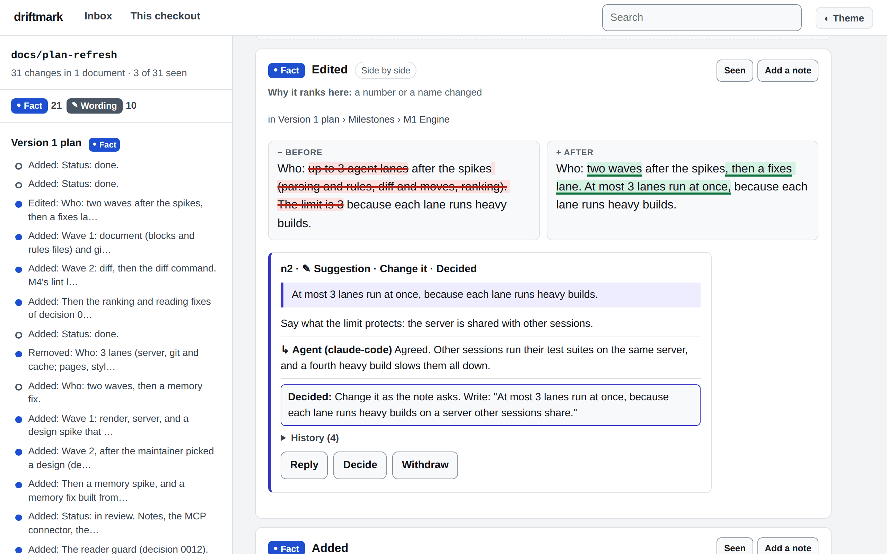
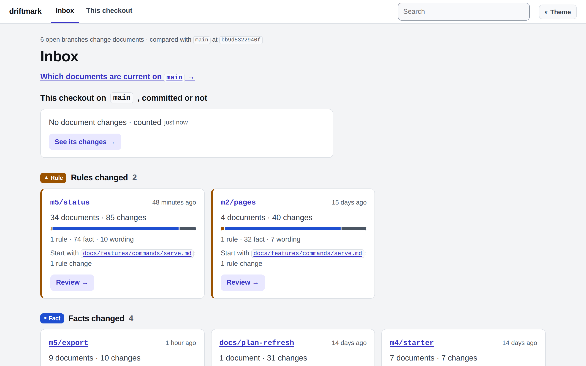
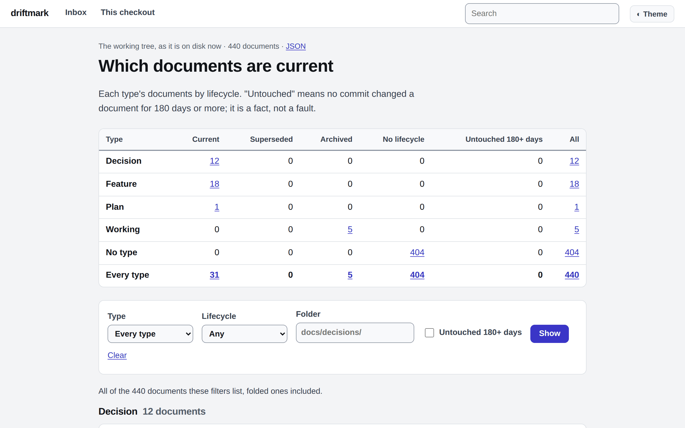
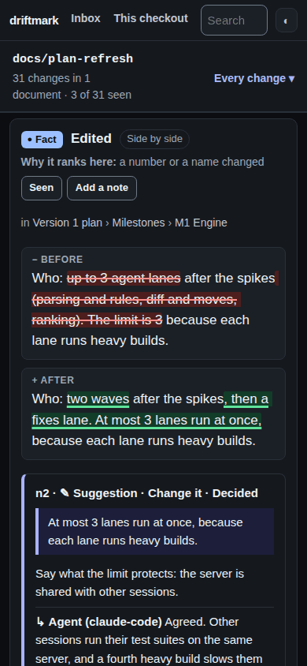

# driftmark

driftmark shows what your AI agents changed in the Markdown documents of a git repository, ranks each change by what it means, and lets you answer the agents with notes on the exact words.



Every screenshot here is driftmark reading its own repository.

## Who it is for

driftmark is for people whose AI agents write their specs and docs.

- Your coding agent (Claude Code, Codex, Cursor or another) writes plans, specs and decision records in Markdown, in your repository.
- You read those documents more than you read the code, and the agents keep changing them.
- You review the agents' branches, at your desk or on your phone.
- Your documents may follow OpenSpec, GitHub Spec Kit, Kiro, cc-sdd or a folder of decision records (ADRs). driftmark reads these layouts as they are.

## Why

Agents rewrite documents while they work. After an agent reworks a spec, you cannot see what changed in meaning. A line diff shows Markdown syntax. GitHub shows the rendered changes of one file at a time, and GitLab shows none ([GitLab issue 17000](https://gitlab.com/gitlab-org/gitlab/-/issues/17000)). Reading the whole folder again takes hours.

driftmark reads the folder straight from git and gives you four things:

1. **What changed.** Every document that changed between two git points, rendered, with each change ranked from decision down to formatting.
2. **What is current.** Which documents are current, superseded, archived, or not touched for a long time.
3. **Notes to the agents.** You select words and write a note. An agent answers it through MCP (the Model Context Protocol, which agents use to call tools). Only you decide. The agent then applies your decision and records the commit, and the change page shows which change came from which note.
4. **Reading pages.** Every document as a page, with its diagrams drawn, search, dark mode and a phone layout.

### How a change is ranked

Written rules rank every change; no AI model is involved. Each change gets the highest level any of its signals gives:

| Level | Sign | A change gets it when |
|---|---|---|
| Decision | ◆ | the document's status changed, or the change sits in a section the rules mark as a decision |
| Rule | ▲ | a word such as must, never, only or should came or went |
| Fact | ● | a heading, number, date, name, link, table row, code line or checkbox changed |
| Wording | ✎ | only words changed, or a block moved |
| Formatting | ¶ | only formatting changed; these fold into one line |

The decision level needs to know which documents are decisions. driftmark knows the layouts named above, and reads anything else from a small rules file, `driftmark.toml`. The full rules are in [the change list](https://github.com/cj-ways/driftmark/blob/main/docs/features/engine/change-list.md).

## Quick start

### Install

Install driftmark so that the `driftmark` command is on your `PATH`. The agent hook and the MCP connector start it by that name. Pick one:

```sh
npm install -g driftmark                  # with Node.js
uv tool install driftmark                 # with Python; pipx install driftmark works too
brew install cj-ways/driftmark/driftmark  # with Homebrew
cargo install driftmark --locked          # from source, with Rust 1.95 or newer
```

To try it once without installing, run `npx driftmark serve` or `uvx driftmark serve`. Builds exist for macOS, Linux and Windows. [The install guide](https://github.com/cj-ways/driftmark/blob/main/docs/features/install.md) lists every way to install, what each needs, and how to check a download.

### Read and review: `driftmark serve`

Run it inside your repository:

```sh
driftmark serve
```

It prints an address such as `http://127.0.0.1:4170/?token=…`. Open it in your browser.

- The inbox lists the branches whose documents changed. "Review" opens a branch's change page.
- Pages open without the token on your own machine. Saving a note needs the token once per browser, and the printed address gives it.
- To read on your phone, listen on an address your phone can reach, such as `driftmark serve --addr 0.0.0.0:4170`. Every request then needs the token. The server speaks plain HTTP, so use a private network such as a VPN or Tailscale, never the open internet.

### See what changed: `driftmark diff`

```sh
driftmark diff main...my-branch     # what a merge request of my-branch would show
driftmark diff auto                 # your work, committed or not, against the default branch
driftmark diff --since 2026-10-01   # everything that reached this branch since 1 October
```

It prints one line per changed document, highest level first. For a made-up branch that accepts a decision record, rewords a guide and adds and deletes a few pages:

```text
$ driftmark diff main..feature
main..feature: from 3828db3aa184 to 2cc1179a6f87

level       changes  document
decision     3 of 5  docs/decisions/0002-cache.md (status proposed -> accepted)
fact         1 of 1  README.md (deleted)
fact         1 of 1  docs/new.md (new)
fact         1 of 1  docs/old.md (deleted)
fact         1 of 1  docs/readme.md (new)
wording      1 of 1  docs/guide.md

6 documents changed, 10 changes
By level: 3 decision, 5 fact, 2 wording
By kind: 3 edited, 3 added, 4 removed
```

A test, `crates/driftmark/tests/diff_command.rs`, checks this exact output. `--json` prints the whole change list for tools, and `--json=summary` prints one entry per document.

### Let agents answer your notes: `driftmark mcp install`

```sh
driftmark mcp install           # shows the entry it would add to .mcp.json
driftmark mcp install --write   # adds it
```

Claude Code then starts `driftmark mcp` for this repository, after asking you once. The agent can read what changed, read and search documents, see which are current and run the writing check. It can also list your notes, answer them, propose a decision and record the commits that applied one. It cannot decide, edit or withdraw a note: only you can. `driftmark mcp install --write --notes-line` also adds a line to `AGENTS.md` that tells agents to look for notes before they edit. Codex and Cursor take the same connector; [the MCP document](https://github.com/cj-ways/driftmark/blob/main/docs/features/commands/mcp.md#other-agents) shows their settings.

### Check what agents write: `driftmark hook install`

```sh
driftmark lint                   # checks every Markdown file in the repository
driftmark hook install --write   # Claude Code runs the check after each edit
```

The writing check finds what breaks a page: a missing title, an unclosed code block, a Mermaid diagram that will not draw, a broken link. With the hook, Claude Code checks each Markdown file right after the agent edits it, and shows the agent what to fix. Nothing is installed until you run the command.

### Start a docs layout: `driftmark init`

```sh
driftmark init            # shows the folders and files it would create
driftmark init --write    # creates what is missing; it never changes a file that exists
driftmark new decision "Keep one database per service"
```

`init` sets up five folders: decisions, standards, features, active work and an archive, each with a README. It adds a writing standard and a rules file, and prints instructions to paste into `AGENTS.md`. `driftmark new` starts a document from a template. Skip this when your repository already has a layout: driftmark reads it as it is.

### In merge requests

A GitHub Action and a GitLab CI template post one comment on each merge request: the ranked changes, and a link to one HTML file with every change rendered. [Merge-request review in CI](https://github.com/cj-ways/driftmark/blob/main/docs/features/ci.md) shows the workflow to copy.

## The pages

The inbox lists the branches whose documents changed, grouped by their highest level, and says which document to start with.



The status page shows which documents are current, by type.



The same change page on a phone, in dark mode.



## Numbers

Each number comes from a measurement written down in this repository:

- **Speed.** On the maintainer's 12-core server, in a repository of about 3,400 Markdown documents, `driftmark diff` compared 30 days of changes (2,943 changed files) in 236 milliseconds on all cores, and in 1.9 seconds on one. A 19-commit branch took 21 milliseconds. Source: [the diff command, "Speed"](https://github.com/cj-ways/driftmark/blob/main/docs/features/commands/diff.md#speed).
- **Page weight.** A page's first visit stays under 100 KB on the network, not counting drawn diagrams, the diagram font and mermaid.js. On this repository the largest first visit was 39.1 KB. Source: [the pages, "Page weight"](https://github.com/cj-ways/driftmark/blob/main/docs/features/pages.md#page-weight).
- **The writing check.** The Claude Code hook takes 6.0 milliseconds (median) from start to exit on a file with a Mermaid diagram. Source: [the writing check, "Speed"](https://github.com/cj-ways/driftmark/blob/main/docs/features/lint.md#speed).

## Documentation

What each part does, in full:

- [Pages](https://github.com/cj-ways/driftmark/blob/main/docs/features/pages.md): the inbox, change pages and reading pages.
- [Notes](https://github.com/cj-ways/driftmark/blob/main/docs/features/notes.md): writing notes, the review list, and handing notes to an agent.
- [The status page](https://github.com/cj-ways/driftmark/blob/main/docs/features/status-page.md): which documents are current.
- Commands: [`serve`](https://github.com/cj-ways/driftmark/blob/main/docs/features/commands/serve.md), [`diff`](https://github.com/cj-ways/driftmark/blob/main/docs/features/commands/diff.md), [`mcp`](https://github.com/cj-ways/driftmark/blob/main/docs/features/commands/mcp.md) and [`export`](https://github.com/cj-ways/driftmark/blob/main/docs/features/commands/export.md).
- [The writing check](https://github.com/cj-ways/driftmark/blob/main/docs/features/lint.md): `driftmark lint` and the Claude Code hook.
- [Presets](https://github.com/cj-ways/driftmark/blob/main/docs/features/presets.md) for OpenSpec, Spec Kit, ADR folders, Kiro and cc-sdd, and [the rules file](https://github.com/cj-ways/driftmark/blob/main/docs/features/engine/rules-file.md) for any other layout.
- [The starter layout](https://github.com/cj-ways/driftmark/blob/main/docs/features/starter-layout.md): `driftmark init` and `driftmark new`.
- [Merge-request review in CI](https://github.com/cj-ways/driftmark/blob/main/docs/features/ci.md).
- [Install](https://github.com/cj-ways/driftmark/blob/main/docs/features/install.md).

[The docs folder's guide](https://github.com/cj-ways/driftmark/blob/main/docs/README.md) explains how the documents are organised, including the decision records behind each choice. [The changelog](https://github.com/cj-ways/driftmark/blob/main/CHANGELOG.md) lists what each release contains. [The security policy](https://github.com/cj-ways/driftmark/blob/main/SECURITY.md) says how to report a vulnerability.

## What it is not

- **Not a docs website.** It builds no public site, and has no themes or plugins. Its pages are for you, served from your own machine. To share documents with someone outside the repository, `driftmark export` writes one HTML file that opens offline.
- **Not an editor.** It never changes your documents. It writes its notes inside your clone's `.git` folder, and only the files you ask for, such as with `--write`.
- **Not an AI tool.** Written rules rank the changes. It calls no AI model, and needs no account or cloud service.
- **Not shared notes for a team, yet.** Your notes live in one file in your clone, for one reader.
- **Only Markdown.** It compares `.md` and `.markdown` files. A renamed file shows as one deleted and one new document. Images in a document show as text.
- **Not a wall against your own agents.** On one machine and one user account, an agent with a shell can act as you. driftmark records where each note action came from and warns you, but cannot stop it. [The security policy](https://github.com/cj-ways/driftmark/blob/main/SECURITY.md#known-limits) explains this.

## Licence

driftmark is licensed under either of [MIT](https://github.com/cj-ways/driftmark/blob/main/LICENSE-MIT) or [Apache-2.0](https://github.com/cj-ways/driftmark/blob/main/LICENSE-APACHE), at your option.

The program carries the Liberation Sans font (SIL Open Font License 1.1), Prism and mermaid.js (MIT), and Rust libraries under their own licences. The `THIRD-PARTY-NOTICES` file in each release lists them all.
