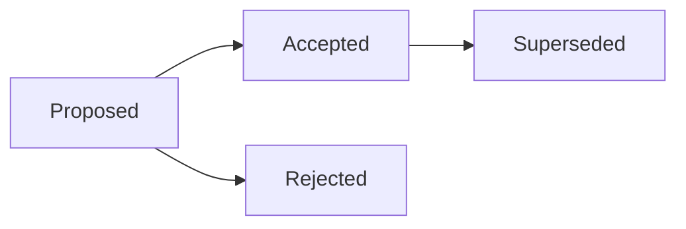

# Writing rules

> Short version: every document has the same shape and uses plain, short sentences. Diagrams are Mermaid, code blocks are closed and name their language, raw HTML comes from a short list, and links are relative Markdown links. Then people can read a document on any screen, and agents read it for few tokens.

## Why these rules

- People read these documents on GitHub, in an editor, on a phone and in driftmark. Plain Markdown in one shape looks right in all of them.
- AI agents read and rewrite the documents many times a day. Markdown costs them fewer tokens than HTML or JSON, and a short document in a known shape costs fewer still.
- A rule that lives only on paper is soon forgotten. `driftmark lint` checks most of these rules after each edit, so they hold.

## The shape of a document

1. **Front matter.** YAML between two `---` lines comes first. It holds `status` and `date`. The date is the day the document last changed in substance. Each folder's README lists the statuses its documents use.
2. **One title.** A single `#` heading comes next.
3. **A short version.** A `>` quote under the title says what the document says, in one or two sentences. A reader in a hurry can stop there.
4. **Sections.** `##` headings follow. A heading never skips a level, so a `####` heading only comes under a `###` heading.

```markdown
---
status: accepted
date: 2026-03-02
---

# 0004 Keep each service's data in its own database

> Short version: every service gets its own database, so a change to one never stops another.

## Situation

Three services share one database today. Last month a schema change in one of them stopped the other two for 40 minutes.
```

`driftmark new` starts a document in this shape.

## Sentences

- **The answer first.** The first sentence of a document, a section or a list item says the conclusion. Reasons and details follow it.
- **One idea per sentence.** A sentence with two ideas becomes two sentences.
- **Short sentences.** Most sentences have fewer than 20 words.
- **Everyday words.** Write "use", not "utilise"; "start", not "commence"; "about", not "approximately".

## Diagrams

- Draw diagrams in Mermaid. GitHub, GitLab and driftmark draw it from its text. A change to a diagram then shows in a diff like any other change, which a picture of a diagram cannot do.
- Write the language in lower case, as `mermaid`. GitHub shows a block marked `Mermaid` as code.
- D2 is allowed for architecture pictures. GitHub and GitLab show D2 as code, and driftmark draws it only where the `d2` program is installed.

For example, the life of a decision record:



## Code blocks

- Fence every code block with three backticks, and close it. An unclosed fence turns the rest of the file into code.
- Name the language after the opening fence, such as `sh` or `toml`. Write `text` for plain text and for what a program printed.
- Keep code lines to 120 characters, so they fit without scrolling. A `text`, `console`, `output` or `log` block may hold longer lines, because pages wrap them.

````markdown
```sh
make release
```
````

## Raw HTML

- Write everything in Markdown where you can.
- Raw HTML may use only `<details>`, `<summary>`, `<br>`, `<sub>`, `<sup>` and `<kbd>`. Markdown cannot write these, and they look the same everywhere.
- HTML comments are allowed, because they show nowhere. Templates use them for guidance that the writer replaces with text.
- For a note or a warning, use an alert:

```markdown
> [!NOTE]
> The cache is emptied at every release.
```

## Links

- Link with relative Markdown links, such as `[the cache standard](../standards/cache.md)`. They work on GitHub, GitLab, in editors and in driftmark.
- Link to a section with its anchor, such as `setup.md#install`.
- Never write wiki links such as `[[cache]]`. Many tools do not follow them.
- Use a full web address only for a page outside the repository.

## Size

- A table has at most 8 columns, so it fits on a phone.
- A heading has at most 100 characters. A longer heading is a sentence, which belongs in the text under it.
- A file has at most 100,000 bytes. Split a larger file into documents that link to each other.

## Checking

- `driftmark lint` checks every Markdown file in the repository. For each problem it names the file, the line and the fix.
- It checks every rule on this page except three groups: the rules under "Sentences", the rules on D2 and alerts, and the rule on wiki links.
- `driftmark hook install` runs the check after every edit Claude Code makes, so an agent fixes its own mistakes right away.
- The size limits and the HTML list live in the `[lint]` table of `driftmark.toml`.
