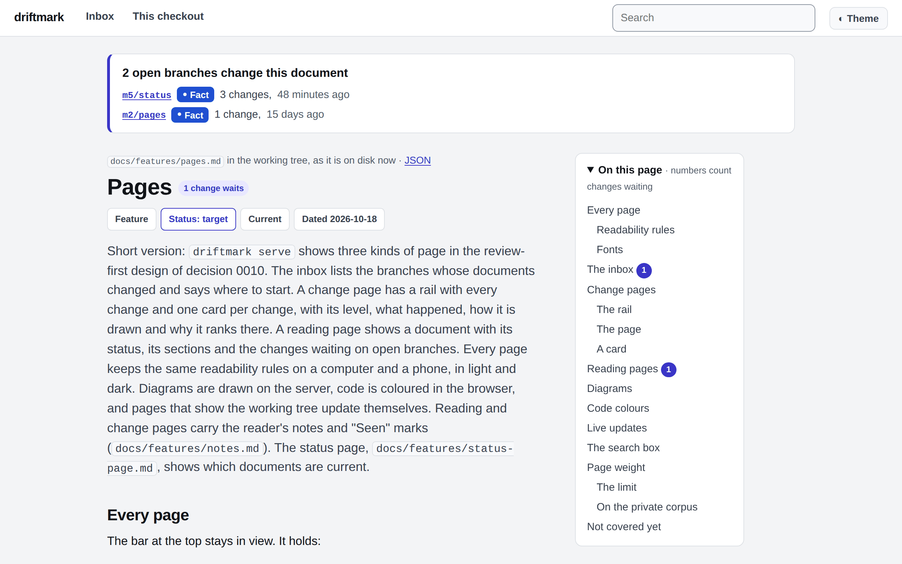

# The docs folder

> Short version: driftmark's own documents, and how to read them. Decision records say why each choice was made, feature documents say exactly what each part does, and the working folder holds the version 1 plan and the experiments behind it. The easiest way to read them is with driftmark itself.

## Where to start

- **To use driftmark:** read [the project README](../README.md), then [the pages](features/pages.md) and [notes](features/notes.md).
- **To know why it is built this way:** read [decision 0001](decisions/0001-the-product-is-docs-change-review.md), what the product is, and [decision 0005](decisions/0005-version-1-scope.md), what version 1 contains.
- **To build on its output:** [the change list](features/engine/change-list.md) holds the JSON contract of `driftmark diff`, and [the MCP connector](features/commands/mcp.md) lists every tool an agent can call.

## The folders

The folders follow driftmark's own starter layout ([the starter layout](features/starter-layout.md)). This repository has no standards or archive folder yet.

| Folder | What it holds | How it changes |
|---|---|---|
| [`decisions/`](decisions/) | One record per decision, numbered in order: the situation, the options, the decision and what it costs. | Written once. A later record replaces an earlier one; it never edits it. |
| [`features/`](features/) | The decided target of each part: what it does, exactly, with made-up examples. | Changed when the target changes. |
| [`features/commands/`](features/commands/) | One document per command: `serve`, `diff`, `mcp` and `export`. | As above. |
| [`features/engine/`](features/engine/) | The rules inside the `driftmark-core` library: the document model, the change list, git ranges, the rules file, page HTML, notes and search. | As above. |
| [`working/version-1/`](working/version-1/) | The version 1 plan, and in `spikes/` the findings of small experiments that tested risky ideas before the build. | Changed while the work goes on. A finished spike stays as a record. |
| [`images/`](images/) | The screenshots in the README and here. | Taken again when the pages change. |

## How to read a document

- **The title and the short version come first.** Every document starts with a `#` title and a `>` short version. The short version often says enough.
- **The status sits in the front matter**, the lines between `---` at the top, with the date:

  | Kind | Status | Meaning |
  |---|---|---|
  | Decision record | `accepted` | Decided. It holds until a later record replaces it. |
  | Feature document | `target` | What the part does. The code and its tests follow it. |
  | Plan | `active` | The work is going on. |
  | Spike findings | `done` | The experiment ended; its findings led to a decision. |

- **A later decision wins.** Records are not edited after they are accepted. When two records disagree, the one with the higher number holds. For example, decision 0011 settles where the notes file lives, which decision 0004 left open.
- **Examples are made up.** Every example repository, document and name in these documents is invented, and so is every file in `fixtures/`.
- **"The private corpus"** is the maintainer's own work repository, of about 3,400 documents, which is not public. Measurements on it record numbers only: no path, title or text from it.

## Read them with driftmark

driftmark reads this folder better than a file list does. In a clone of this repository:

```sh
driftmark serve
```

Then open the printed address, and from there:

| Address | What it shows |
|---|---|
| `/lifecycle/main` | Which documents are current, by type. |
| `/doc/main/-/docs/README.md` | This document, as a reading page. Its links lead to the other documents. |
| `/doc/main/-/docs/decisions/0001-the-product-is-docs-change-review.md` | The first decision record. |
| `/` | The inbox: branches whose documents changed. |

This repository's `driftmark.toml` names the starter preset, so each document shows its type, its status and its lifecycle.



To read the whole folder offline, without a server, write it as one HTML file:

```sh
driftmark export folder main docs -o driftmark-docs.html
```
