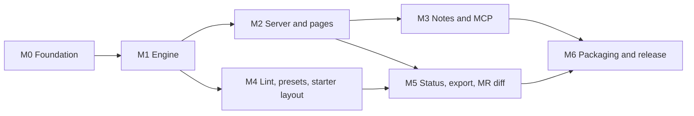

# Version 1 plan

> Short version: seven milestones, from an empty repo to a public release. The engine comes first, then pages, then notes, so the change view and the notes loop are usable before packaging. Every agent brief is signed off by the maintainer before the agent starts.

## How the work runs

- **Where.** On the server, in `/root/cj-ways/driftmark`. Builds and tests run there.
- **Who.** One coordinating session plans each milestone and checks every result. Implementation agents each work in their own git worktree and branch.
- **Approvals.**
  - Before each wave, the maintainer reads and signs off each agent's brief: goal, what changes, decisions baked in, limits, and what "done" means.
  - Before each step, the coordinator explains it in plain words and asks.
  - A commit or push needs his OK, unless he gives this repo a standing approval.
- **Fresh code.** The design comes from the private prototype (decision 0003). No code is copied from it.
- **Quality bar**, copied from cj-ways/acctswap:
  - `cargo fmt`, `cargo clippy` and tests on Linux, macOS and Windows in CI.
  - 100% line coverage on the core crate, mutation testing with `cargo mutants`, and licence checks with `cargo deny`.
- **Test data.**
  - Synthetic fixtures committed in the repo.
  - Public repos (OpenSpec, Spec Kit, an ADR repo), fetched at pinned commits in CI.
  - The maintainer's private corpus of about 3,400 files, used only on the server and never committed.
- **Crates.**
  - `driftmark-core` holds the rules and touches no file, git or network: blocks, rules files, diff, ranking, anchoring and lint rules.
  - `driftmark` is the program: the git reader, the server, SQLite, the MCP connector, rendering and the commands.

## Milestones

### M0 Foundation

- **Builds:** the Cargo workspace with both crates, CI, licence files, `AGENTS.md` and `CLAUDE.md`, a `STATUS.md` kept out of git, and a fixture corpus skeleton.
- **Approval needed:** reserving the name on npm, crates.io and PyPI, by publishing empty `0.0.0` packages.
- **Done when:** CI is green on all three systems with a placeholder test.
- **Who:** the coordinator, no agents.

### M1 Engine

**It starts with three spikes.** A spike is a small experiment of at most a day:
1. Map a text selection on a rendered page back to Markdown source offsets with comrak. Notes depend on this.
2. Draw every Mermaid diagram in the private corpus and in the pinned public repos with merman, and count how many come out right.
3. Parse and diff the whole private corpus between two real commits, and time it.

**It builds:**
- Blocks, where each list item and each table row is its own block.
- Rules files, plus reading status from frontmatter and from `> Status:` lines.
- Block pairing by shared words, and the choice of view by words kept in order.
- Moves, including blocks that moved and were also edited.
- Folding of formatting-only changes, and the ranking rules.
- `driftmark diff <base>..<head> --json`.

**Done when:**
- Golden tests pass on fixtures that include the prototype's known failures:
  - a new block between two edited blocks is listed in its place;
  - a block that moved and was edited is found;
  - an edited list item marks only that item.
- The core crate has 100% line coverage.
- On the maintainer's server, 30 days of changes diff in under 1 second with all cores and under 5 seconds on one core, and a typical branch in under 0.1 seconds (decision 0008).

**Who:** up to 3 agent lanes after the spikes (parsing and rules, diff and moves, ranking). The limit is 3 because each lane runs heavy builds.

### M2 Server and pages

**It builds** `driftmark serve`:
- It reads any branch from git when a page opens, and caches by file hash.
- Home page: the branches with document changes.
- Reading pages and change pages, with styled tables, callouts, dark mode and a phone layout.
- Mermaid drawn on the server, with the browser as a fallback. D2 through `d2` when it is installed.
- Search.
- A login token for use from another device.
- A page-weight limit for the phone, set in the brief.

**Done when:**
- The maintainer reads real documents, and a real agent branch's changes, on his Mac and his phone.
- Every page state has a screenshot.
- The first page stays under the weight limit.

**Outside this repo, with its own approval:** run driftmark beside the maintainer's current docs site, then move his bookmark.

**Who:** 3 lanes (server, git and cache; pages, styling and diagrams; search).

### M3 Notes and MCP

**It builds:**
- The SQLite store, with anchoring and re-anchoring.
- Notes on reading and change pages, and a review list.
- Sending notes as a prompt or a review file.
- Statuses and decisions for each note.
- `driftmark mcp` with its tool list, and a setup command for Claude Code.

**Done when:**
- One real review round runs end to end on a real agent branch:
  - notes are written on the phone and the Mac;
  - the agent replies through MCP;
  - the maintainer decides;
  - the agent applies the changes and records the commits;
  - the change page shows "changed because of note N".
- Re-anchoring tests pass across synthetic edits.

**Who:** 2 lanes (store, anchoring and UI; MCP).

### M4 Writing check, presets, starter layout

**It builds:**
- `driftmark lint`, covering:
  - the rules in decision 0002;
  - Mermaid validity;
  - the frontmatter schema;
  - link targets.
  It reports each failing file by name, also as JSON.
- `driftmark hook install` for Claude Code, and a CI mode.
- Presets for OpenSpec, Spec Kit, ADR folders, and Kiro and cc-sdd.
- `driftmark init`, which creates the starter layout with templates and writing rules.

**Outside this repo, with its own approval:** the maintainer's company rules file, written in that company's repo.

**Done when:**
- Each preset is tested against a pinned public repo, and the status view shows the right document types.
- A lint report exists for the private corpus.
- A layout made by `init` passes its own lint.

**Who:** 3 lanes (lint and hook; presets; starter layout). Lint and presets need only M1, so they can run in parallel with M2 and M3.

### M5 Status view, export, merge-request diff

**It builds:**
- The status page.
- `driftmark export`, which writes one self-contained HTML file.
- A GitHub Action and a GitLab CI template that render a merge request's document changes and post a comment with a link.

**Done when:**
- A test merge request on GitHub and one on GitLab each show the link to the rendered changes.
- An exported file opens offline with its diagrams.

**Who:** 3 lanes.

### M6 Packaging and public release

**It builds:**
- A release workflow for six systems, with checksums and an attestation.
- Packages for crates.io, PyPI (through maturin), npm and a Homebrew tap in cj-ways. The npm package shape is decided by binary size: one package like acctswap if it is small enough, otherwise one package per system.
- A README with screenshots, `SECURITY.md`, and user docs.

**Approval needed:**
- Ownership is confirmed.
- The repo goes public.
- The first release is published.

**Done when:**
- `npx driftmark`, `uvx driftmark`, `brew install` and `cargo install` work on macOS, Linux and Windows.
- A dry run of the release workflow builds everything and publishes nothing.

## Open items

1. **Ownership.** The maintainer confirms the code is his before the repo goes public.
2. **Name.** Reserving it on the registries, in M0, needs his approval.
3. **Commits.** Whether this repo gets a standing approval for commits and pushes, like acctswap.
4. **Notes file.** Where it lives: inside `.git/driftmark/` or in the user's data folder. Decided in the M3 brief.
5. **Version number.** The first public release is either `0.1.0` or `1.0.0`.
6. **npm shape.** Decided in M6.
7. **Scope still open in decision 0005:**
   - moves between documents;
   - several repos behind one server;
   - AI importance labels.
8. **The maintainer's work repo.** Its rules file, the switch of the always-on site, and the retirement of the prototype each need their own approval there.
