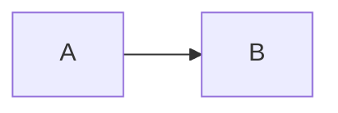

# Every block kind

> One file that holds each kind of block once.

## Prose

A paragraph with *emphasis*, **strong text**, `code`, a [link](other.md) and a
second line.

Setext heading
--------------

- A bullet item
1. An ordered item

- [ ] An open task
- [x] A done task

| Name | Size |
|:-----|-----:|
| apple | 3 |
| pear | 12 |

```rust title="main.rs"
fn main() {}
```

    indented code



```d2
a -> b
```

```
no language
```

> [!WARNING]
> Back up the data first.

> A quoted paragraph.

A sentence with a note.[^note]

[^note]: The note itself.

<details>
<summary>More &amp; less</summary>
</details>

***

[unused]: https://example.com/unused
