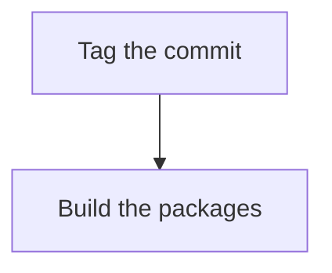

# Release checklist

> Short version: the steps to ship a release of the made-up `shipit` tool, from tagging the commit to checking the packages.

## Steps

1. Tag the commit.
2. Build the packages.

## Checks

Run the tests before tagging.

