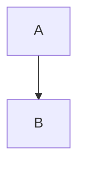

# Diagrams

A diagram the program draws:



A diagram whose drawing fails:

```mermaid
graph TD
  fail "here"
```

A D2 diagram the program does not draw:

```d2
a -> b
```

A diagram that is never closed:

```mermaid
sequenceDiagram
  A->>B: hello
